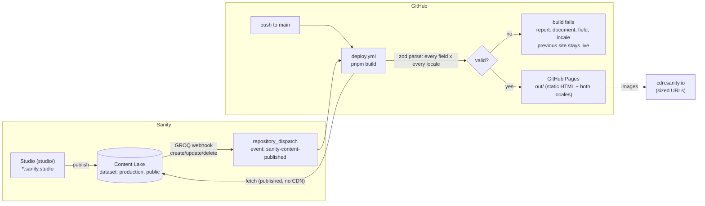

# ADR-003 — Sanity as the CMS for bilingual (EN/FR) content, built statically for GitHub Pages

- **Date:** 2026-10-13
- **Status:** `accepted` (implemented 2026-10-14, see [Implementation notes](#implementation-notes-2026-10-14))
- **Deciders:** Carlos Gonzalez Lo Vullo (owner), architect agent

## Context

All portfolio content is hard-coded today, in two places:

- `src/_pages/home/model/*.ts`: the structure of the content (job ids, project categories, technologies, tints, screenshots, reading times);
- `src/_pages/home/ui/*/messages.ts`: the wording, as `Localized<T>` objects (`Record<'en' | 'fr', T>`, from `src/shared/lib/i18n`).

Editing a project, a note or a job means a commit and a deploy, and the wording is mixed with the UI copy (labels, aria, form). The owner wants to edit content without touching code, in both languages, without ever shipping a blank or half-translated page.

Constraints:

- **Hosting is GitHub Pages**: a static export (`output: 'export'`). There is no server at runtime, so content is fetched **at build time** only.
- **The locale is a client-side toggle** (`useLocale` + `localStorage`, no `/en` or `/fr` routes). The static HTML is rendered in the default locale (`en`), and the other locale is applied after hydration. Every content item must therefore be shipped **in both locales** to the client, as the current `messages.ts` files already are.
- **Missing translations are a hard requirement**: a missing FR (or EN) value must never reach production silently.
- FSD + Atomic Design is enforced by `pnpm lint:arch` (ADR-002). Steiger fails on a slice referenced only once (`fsd/insignificant-slice`).
- Strict TypeScript, zod 4 is already a dependency, and the env is validated in `src/shared/config/env.ts`.

Not deciding means the content stays in code, and every typo fix needs a developer.

## Options considered

### 1. Localization model

#### Option A — Field-level, `sanity-plugin-internationalized-array` (chosen by the owner)

There is one document per thing (one `project`, one `job`). Each translatable field is an array of `{ _key, language, value }` items. Since **v5 (March 2026)**, the plugin stores the language in a dedicated `language` field; v4 used `_key`. GROQ filters with `field[language == "fr"][0].value`.

- Pros: language-neutral data (technologies, URLs, dates, tints, images, ordering) is entered once and cannot drift between locales. Both locales are published together in one transaction, so a published document is complete by construction once validation requires both locales. It scales in attributes (no new attribute per language). It matches the frontend shape (`Record<Locale, T>`).
- Cons: a locale cannot be published on its own. That is fine for a one-author portfolio that is always kept in both languages. Two languages per field make the form denser, which `@sanity/language-filter` or a compact `languageDisplay` can offset.

#### Option B — Document-level, `@sanity/document-internationalization` (rejected)

There is one document per locale, linked by a `translation.metadata` document.

- Pros: locales are published independently, and it suits long-form, locale-specific pages.
- Cons, decisive here:
  - **Duplication**: most fields (technologies, URLs, dates, images, tints, categories, order) are language-neutral. They would be stored twice and could drift, for example a project with a demo URL in EN and none in FR.
  - **Robustness**: "FR is missing" becomes "a whole document is missing", detectable only by a cross-document query. That is harder to enforce in the Studio, because validation is per document, and harder to report precisely.
  - **Independent publishing goes against the requirement**: it allows EN to go live while FR is still a draft, which is exactly the state we want to forbid.
  - It needs more machinery: metadata documents, initial-value templates, and joins in every query.

### 2. Hosting and rendering

#### Option A — GitHub Pages, static export, rebuild on publish (chosen)

A Sanity GROQ webhook sends `POST` to `repository_dispatch` on GitHub, which runs `pnpm build` and then deploys `out/` to Pages.

- Pros: it is free, needs no server and has no runtime dependency on Sanity (the site stays up if Sanity is down). It keeps a minimal attack surface: no API route, no runtime token.
- Cons: a publish shows up after a full build, in about 2 to 4 minutes. There is no live preview or Visual Editing, no `next/image` optimizer (see the Images section) and no server-side locale negotiation.

#### Option B — Vercel, with ISR, `defineLive` and Visual Editing (rejected for now)

- Pros: content updates in seconds through tag revalidation, and click-to-edit Visual Editing with the Presentation tool and Draft Mode is available. The image optimizer works.
- Cons: it adds a second platform and account, a read token on the server, draft-mode routes and webhook endpoints to secure. Runtime rendering can fail on a Sanity outage unless it is carefully cached. The benefits (instant updates, live preview) matter little for a portfolio edited a few times a month.
- Revisit if: preview while editing becomes a real need, or a form needs a server action. The content layer below (queries, zod schemas, resolver) carries over unchanged. Only the fetching helper and the deploy change.

### 3. Studio location

#### Option A — Standalone Studio in `studio/` in this repo, deployed with `sanity deploy` to `<name>.sanity.studio` (chosen)

- Pros: Sanity now recommends it over embedding. It builds with Vite, which is fast, auto-updates, and supports TypeGen watch mode. The schema and the queries live in one repo, so TypeGen can scan `../src`. The web build does not grow.

#### Option B — Embedded `/studio` route in the Next.js app (rejected)

- Cons: the Studio is a client-only SPA. Under `output: 'export'`, its catch-all route `[[...tool]]` would need `generateStaticParams`, and the Studio would be published on the public site. It slows `next build` and ties Studio updates to site deploys. Sanity documents this setup as legacy.

#### Option C — Separate repository (rejected)

It breaks the TypeGen link between the schema and the queries, and needs two repositories for one owner.

## Decision

**Chosen: field-level localization with `sanity-plugin-internationalized-array` (v5+ data format), a standalone Studio in `studio/` deployed to `*.sanity.studio`, and a static export to GitHub Pages rebuilt by a Sanity webhook. Missing locales are blocked at publish in the Studio and fail the build.**

Decisive criteria: no duplicated language-neutral data, completeness enforced on one document at a time, zero runtime infrastructure, and a failure mode that keeps the previous site online.

### Architecture



### Content inventory: what moves and what stays

Rule: **content** is what the owner writes about themselves and their work. **UI copy** is what the interface says to operate itself (labels, buttons, aria, errors, glyphs, eyebrows tied to the nav order, filter labels tied to a code enum). UI copy stays in `ui/*/messages.ts`.

| Source today                                                                                     | Moves to Sanity                                                                                                                                                                                                               | Stays in code                                                                                                          |
| ------------------------------------------------------------------------------------------------ | ----------------------------------------------------------------------------------------------------------------------------------------------------------------------------------------------------------------------------- | ---------------------------------------------------------------------------------------------------------------------- |
| `config/site.ts`                                                                                 | `OPEN_TO_WORK` → `siteSettings.openToWork`; `CONTACT_EMAIL`; `SITE_LINKS.github`/`linkedin` → `siteSettings`; `resume.pdf` → `siteSettings.resume` (file asset, optional, last step)                                          | `TYPE_SPEED_MS`, `CLOCK_TIME_ZONE`, `CALENDLY_URL`                                                                     |
| `ui/messages.ts`                                                                                 | `metadataTitle`, `metadataDescription` → `siteSettings.seo` (localized; `<head>` uses `en`, see Consequences)                                                                                                                 | —                                                                                                                      |
| `ui/hero/messages.ts`                                                                            | `badge`, `titleStart`/`titleHighlight`/`titleEnd`, `lead`, `terminal.script` (8 lines), `terminal.stats.focusValue` → `homePage.hero`                                                                                         | `exploreWork`, `getInTouch`, `socials`, `newTab`, `arrow`, terminal `title`/`live`/`prompt`, stat labels, `buildValue` |
| `model/terminal.ts`                                                                              | —                                                                                                                                                                                                                             | `TERMINAL_SCRIPT_STYLE` (line tones are presentation; the script must have 8 lines, enforced by validation)            |
| `model/experience.ts` + `ui/experience/messages.ts`                                              | `job` documents: `company`, `role`_, `startDate`, `endDate?` (date fields, formatted with `Intl` and replacing the hand-written `dates`), `achievements[]`_, `technologies[]`, `tint`; section `title`* → `homePage.sections` | `eyebrow`, `technologiesLabel`, "Present" label                                                                        |
| `model/skills.ts` + `ui/skills/messages.ts`                                                      | `homePage.skills`: `coreStack[] {name, tint}`, `backendStack[]`, `aiPractices[] {title*, description*}`, `leadership[] {title*, description*, monogram}`; section `title`*                                                    | `eyebrow`, group titles (`core.title`, `ai.badge`…), which map to fixed layout slots                                   |
| `model/projects.ts` + `ui/projects/messages.ts`                                                  | `project` documents: `title`_, `kind`_, `description`_, `placeholder`_?, `categories[]` (enum), `technologies[]`, `image` (asset, `public/*.png` uploaded), `tint`, `demoUrl?`, `sourceUrl`, `sortOrder`; section `title`*    | `PROJECT_CATEGORIES` enum + filter labels, `demo`/`source` labels and aria builders                                    |
| `model/notes.ts` + `ui/watch/messages.ts`                                                        | `watchNote` documents: `title`_, `publishedAt` (date, replacing `date`), `excerpt`_, `body[]`* (paragraphs), `takeaways[]`_, `category` (enum), `readingMinutes`; section `title`_                                            | `NOTE_CATEGORIES` enum + filter labels, `filterNotes`, meta formatters, dialog labels                                  |
| `ui/contact/messages.ts`                                                                         | `title`_, `lead`_ → `homePage.contact`; LinkedIn display name and GitHub handle → `siteSettings`                                                                                                                              | everything else (tabs, form, errors, sent state, `subject`)                                                            |
| `ui/site-footer/messages.ts`                                                                     | `status.open`_/`status.busy`_, `credits[]`* → `siteSettings`                                                                                                                                                                  | `nextCredit`                                                                                                           |
| `ui/site-nav/messages.ts`                                                                        | `ownerName`, `avatarAlt`*, avatar image (`public/carlos.png`) → `siteSettings`                                                                                                                                                | the rest                                                                                                               |
| `model/tints.ts`, `model/sections.ts`, hooks (`useScrollSpy`, `useTypewriter`, `useListFilter`…) | —                                                                                                                                                                                                                             | unchanged                                                                                                              |

`*` marks a localized field (an internationalized array). Proper nouns (company, technologies, owner name) and URLs are **not** localized: a field is localized only when its text depends on the language.

### Content model (Studio, `studio/schemaTypes/`)

- Singletons, with fixed `_id` and pinned in the Structure: `siteSettings`, `homePage`.
- Collections: `job` (ordered by `startDate desc`), `project` (by `sortOrder asc`), `watchNote` (by `publishedAt desc`).
- Plugin config: `internationalizedArray({ languages: [{id:'en',title:'English'},{id:'fr',title:'Français'}], defaultLanguages: ['en','fr'], fieldTypes: ['string','text'], buttonAddAll: false, restoreOrder: false, languageDisplay: 'titleAndCode' })`. `defaultLanguages` creates both slots on new documents, so the editor sees the empty FR slot. `restoreOrder: false` (plugin v5.2+) avoids drafts created just by opening a document. **Do not** enable `buttonLocations: 'unstable__fieldAction'`: the plugin README marks it as broken since 4.0.4.
- Lists (achievements, takeaways, paragraphs, terminal lines) are `array` of `internationalizedArrayString` / `internationalizedArrayText`. Each item carries both locales, so the EN and FR lists cannot differ in length. Portable Text is not used: the notes are short paragraphs, and plain text avoids a renderer dependency. Revisit if notes need links or emphasis.
- Locales are a **hard-coded constant** in `studio/` (`en`, `fr`), not a `locale` document type as the generic Sanity rule suggests. Two fixed locales mirror `LOCALES` in `src/shared/lib/i18n`, and a document type would add a fetch and an editable surface for no gain. Drift between the two lists is caught by the build check.
- Tint and category enums are duplicated as `options.list` in the Studio (the Studio is a separate package). Drift is caught by the zod enums at build time.

### Robustness: missing translations

**1. Studio (publish-time gate).** Every localized field uses one shared validator, `requireLocales()` in `studio/schemaTypes/validation/requireLocales.ts`. It is a `rule.custom` that returns **one error per missing or blank locale**, attached to the item path (`[{_key}, 'value']`) when the slot exists, or to the field otherwise. Messages read like this: `French (fr) translation is required` and `English (en) is empty`. Errors (not warnings) **block Publish**. The Studio shows them inline on the field, in the document's validation panel, and as a red marker in document lists. Each document type's `preview.prepare` also adds `Missing: fr` to its subtitle whenever a localized field lacks a locale, so gaps can be seen from the list without opening documents. Unknown or duplicate languages are errors too. Required language-neutral fields use `rule.required()`.

**2. Build (deploy-time gate).** GROQ queries return the **raw** internationalized arrays (`title[]{language, value}`), not `coalesce(...)`, so a gap cannot be masked in the query. Each result is parsed by zod. A shared schema `localizedString()` turns `{language, value}[]` into `Record<Locale, string>` and adds one issue per missing, blank, duplicate or unknown locale. The fetch helper formats every issue (not only the first) as `<_type> "<_id>" › <field path> › <locale>: <problem>`, for example `project "project-meeple" › description › fr: missing translation`, and throws. `next build` then fails.

**Fallback policy (explicit):**

| Context                                                    | Missing locale                                                                                                                                                                                       |
| ---------------------------------------------------------- | ---------------------------------------------------------------------------------------------------------------------------------------------------------------------------------------------------- |
| `pnpm build` (CI, deploy and local; `NODE_ENV=production`) | **Fails** with the full report. No fallback, ever.                                                                                                                                                   |
| `pnpm dev`                                                 | Falls back to the other locale, prints one grouped `console.warn` with the same report, and adds a `[missing fr]` prefix to the value so the gap is visible on screen. Both locales missing: throws. |
| Storybook / unit tests                                     | Use typed fixtures and never fetch.                                                                                                                                                                  |

Why not fall back to EN in production: on a recruiting portfolio, a French visitor seeing English text without notice looks like a bug. The Studio gate makes this state almost impossible for published content anyway. If it still happens (a schema change, or a document published before the validator existed), the safe outcome is to keep the previous deploy live and tell the author. Shipping a degraded page is the unsafe one. The dev fallback exists only so that UI work is not blocked by content in progress.

**3. Check outside the deploy.** `pnpm content:check` (a `tsx` script, `scripts/content-check.ts`) runs the same queries and schemas and prints the report, with exit code 1 on any issue. It runs:

- in `ci.yml` on every PR and push. A schema or query change that breaks against the real dataset fails before merge (the dataset is public, so no secret is needed);
- as the first step of `deploy.yml`, for a fast failure and a readable report before the full build.

Unit tests (`pnpm test`) cover `localizedString()` and the error formatter with fixtures: complete, missing `fr`, blank `en`, duplicate language, unknown language, legacy v4 item (`_key` only). There is also a type-level test, `expectTypeOf<HOME_CONTENT_QUERY_RESULT>().toExtend<z.input<typeof homeContentSchema>>()`, so the zod schemas cannot drift from the TypeGen types.

**4. Typed content with TypeGen.** It is configured in `studio/sanity.cli.ts`: `typegen: { path: '../src/**/*.{ts,tsx}', schema: 'schema.json', generates: '../src/shared/api/sanity/sanity.types.ts', overloadClientMethods: true }`. The schema is extracted with `--enforce-required-fields`. Queries use `defineQuery` with **unique, scoped names** (TypeGen silently overwrites duplicates). The generated file is **committed**, and CI runs `pnpm typegen` and then `git diff --exit-code` to catch stale types. TypeGen types the raw shape. Zod enforces what TypeGen cannot (both locales present, enums, non-empty lists) and maps it to the domain types that the UI consumes.

**5. Sanity unreachable at build.** The client runs with `useCdn: false`, which is fresh right after a webhook, and `perspective: 'published'`. `@sanity/client` retries transient errors. A network error, a 4xx or 5xx, a wrong `projectId` or `dataset`, a missing singleton (`null`) or an empty required collection (`jobs`, `projects`) **throws**, and the build fails. There is no try/catch that returns empty arrays, and no committed snapshot fallback. Pages only deploys a successful build, so **the previous site stays online**. The job fails visibly and is retried by re-running it or publishing again.

**6. Images.** `next.config.ts` sets `output: 'export'` and `images: { unoptimized: true }`, because the Next optimizer does not exist on Pages. The resizing is done by the **Sanity image CDN** instead. `src/shared/api/sanity/image.ts` wraps `@sanity/image-url` (`createImageUrlBuilder({ projectId, dataset })`). The project card builds `urlFor(image).width(w).fit('crop').auto('format').url()` and passes `width` and `height` from `asset->metadata.dimensions` to `next/image`, which prevents layout shift. Image fields use `hotspot: true` and a required `alt`, which is localized. `lqip` is queried for the blur placeholder. A later improvement, not required: a global `images.loaderFile` that maps `next/image` widths to Sanity CDN params, for a real `srcset`.

### FSD placement (passes `lint:arch`)

```text
src/
  shared/
    config/env.ts              + SANITY_PROJECT_ID, SANITY_DATASET (default "production"), SANITY_API_VERSION (pinned date)
    api/sanity/                  generic, no business noun
      client.ts                  createClient({ projectId, dataset, apiVersion, useCdn: false, perspective: 'published' })
      fetchContent.ts            fetch + zod parse + issue report + dev fallback policy
      localized.ts               localizedString(), localizedText(): {language,value}[] → Record<Locale,string>
      image.ts                   urlFor()
      sanity.types.ts            generated by TypeGen (committed)
      index.ts                   public API (named exports)
  _pages/home/
    api/queries.ts               HOME_CONTENT_QUERY (one defineQuery, all of the page's content)
    api/getHomeContent.ts        fetchContent(HOME_CONTENT_QUERY, homeContentSchema)
    model/content.ts             zod schemas + domain types (Job, Project, WatchNote, SiteSettings…)
    ui/HomePage.tsx              async server component: awaits content, passes Localized props to sections
studio/                          separate pnpm workspace package, outside src/ (not linted by Steiger)
scripts/content-check.ts
```

- The queries and schemas live in the **page slice**, not in `entities/*`. Only the home page uses them, so new entities would fail `fsd/insignificant-slice`, and ADR-002 says extract on the second consumer. When a second page appears (for example a `/projects/[slug]` detail page), move `project` to `src/entities/project/{api,model}`.
- `shared/api/sanity` imports only `shared/config` and `shared/lib/i18n` (`LOCALES`), so it carries no business logic.
- `HomePage` becomes an `async` server component. The sections stay client components and receive content as props, in the same `Localized<T>` shape that `useMessages` already consumes. `homeMetadata` becomes `generateMetadata()`, reading `siteSettings.seo.en`.
- The root `tsconfig.json` adds `studio` to `exclude`; `studio/` has its own `tsconfig`. Check that `knip`, `eslint` and `vitest` ignore `studio/` or are configured per workspace.

### Configuration and secrets

| Item                 | Value                                                                                                                            | Secret? | Where                                                         |
| -------------------- | -------------------------------------------------------------------------------------------------------------------------------- | ------- | ------------------------------------------------------------- |
| `SANITY_PROJECT_ID`  | from `sanity init`                                                                                                               | no      | `.env.example`, GitHub Actions vars, `studio/sanity.cli.ts`   |
| `SANITY_DATASET`     | `production`                                                                                                                     | no      | same                                                          |
| `SANITY_API_VERSION` | pinned date (for example `2026-10-01`), never `latest`                                                                           | no      | `src/shared/config/env.ts` default                            |
| Read token           | **none**: the `production` dataset is **public**, so published documents are readable anonymously; drafts and versions never are | —       | —                                                             |
| Seed write token     | the user's own login via `sanity exec --with-user-token`; no stored token                                                        | —       | local only                                                    |
| Webhook → GitHub     | fine-grained PAT, **this repo only**, permission `Contents: read & write` (required by `repository_dispatch`), with an expiry    | **yes** | Sanity webhook `Authorization` header only, never in the repo |
| Pages deploy         | `GITHUB_TOKEN` with `pages: write`, `id-token: write`                                                                            | managed | `deploy.yml`                                                  |

- Confirm visibility with `sanity dataset visibility get production`, expecting `public`, which is the default for new datasets. If it is ever made private, add a `SANITY_API_READ_TOKEN` (Viewer) as a GitHub Actions secret, used only by the build. It is never `NEXT_PUBLIC_`.
- Variables are not prefixed `NEXT_PUBLIC_`, because they are read only at build time on the server. The image URL builder runs during prerender, so the browser receives final URLs.
- CORS: add the Studio origin (automatic with `sanity deploy`) and `http://localhost:3333`. The site itself makes no browser-side Sanity calls.
- Webhook: URL `https://api.github.com/repos/goniti/portfolio/dispatches`, `POST`, headers `Authorization: Bearer <PAT>` and `Accept: application/vnd.github+json`. Filter: `_type in ["siteSettings","homePage","job","project","watchNote"]`. Triggers: create, update and delete; drafts and versions off. Projection: `{"event_type": "sanity-content-published", "client_payload": {"id": _id, "op": delta::operation()}}`. The PAT is visible in the webhook config and in share links, so never share the webhook. Rotate the PAT when it expires.
- `deploy.yml` uses `concurrency: { group: pages, cancel-in-progress: true }`, so a burst of publishes collapses into one deploy.

## Consequences

- **Positive:** content is edited in the Studio without a commit. Language-neutral data is entered once. Missing translations are blocked twice, at publish and at build, with precise reports. The site has no runtime dependency on Sanity and no runtime secret. Content is typed from the schema to the props.
- **Negative / accepted trade-offs:**
  - A publish appears after a 2 to 4 minute rebuild. There is no live preview or Visual Editing; see the Vercel alternative.
  - Both locales ship in the page payload (small for this site). `<head>` metadata and the initial HTML are EN only: there are no per-locale URLs, so FR is not indexed separately. This is an existing limitation of the client-side toggle, not introduced here. Per-locale routes (`/en`, `/fr` with `generateStaticParams`) would be a separate ADR.
  - Locales and enums are duplicated in `studio/` and `src/`. Drift is detected by the build check, not prevented.
  - `next/image` is unoptimized. Sizing comes from Sanity CDN URLs instead.
  - A Sanity outage blocks deploys, including code-only deploys. The live site is unaffected.
- **Constraints introduced:**
  - Every new localized field uses `requireLocales()` in the Studio and `localizedString()`/`localizedText()` in zod. Queries never use `coalesce` across locales.
  - The repo becomes a pnpm workspace (root app + `studio/`).
  - `output: 'export'` rules out API routes, server actions, `cookies()` and `headers()`, and ISR. A `basePath` is needed if the site is served from `goniti.github.io/my-portfolio` rather than a custom domain.
  - The adoption of the static export itself is recorded here. If it is reversed (move to Vercel), supersede this ADR.
  - `sanity-plugin-internationalized-array` must stay on v5 or later (`language` field). The generic Sanity agent rule snippet still shows the v4 form `_key == $locale` and must not be copied.

## Implementation plan (ordered)

1. **Sanity project.** Create the project and the `production` dataset (public), and confirm visibility. Record `projectId` in `.env.example` and `env.ts` (zod: required in `production`).
2. **Studio scaffold.** Run `pnpm create sanity@latest --project <id> --dataset production --template clean --typescript --output-path studio`. Add `pnpm-workspace.yaml` (`packages: ['studio']`), exclude `studio` from the root `tsconfig`, eslint, knip and vitest, and add the root scripts `studio:dev`, `studio:deploy` and `typegen`.
3. **Schema.** Install `sanity-plugin-internationalized-array` (v5+, latest at install time). Add the singletons `siteSettings` and `homePage`, the documents `job`, `project` and `watchNote`, `requireLocales()` with its "Missing: fr" previews, and the Structure with pinned singletons. Deploy with `sanity deploy` and `sanity schema deploy`.
4. **Seed.** Add `studio/scripts/seed.ts`, run with `sanity exec --with-user-token`. It imports the current EN and FR content from the `src/_pages/home/**` model and messages files (their `@/` imports are type-only, so they are erased). It maps them to documents with **deterministic `_id`s** (`job-saper-vedere`, `project-meeple`…) and deterministic `_key`s, and uses `createOrReplace` in one transaction, so it is idempotent and can be re-run. It converts `dates` strings to `startDate`/`endDate` and uploads `public/*.png` (and optionally `resume.pdf`) as assets. It finishes by running the content check. Review the documents in the Studio, then publish.
5. **Shared Sanity layer.** Add `src/shared/api/sanity` (client, `localizedString`, `fetchContent` with its report and dev fallback, `urlFor`), with unit tests written first (QA agent). Add `@sanity/client`, `@sanity/image-url` and `groq` (or `next-sanity` for `defineQuery` only; prefer the lighter `groq` package).
6. **Queries, schemas and TypeGen.** Add `_pages/home/api/queries.ts` (`HOME_CONTENT_QUERY`) and `model/content.ts` (zod schemas), configure TypeGen, commit `sanity.types.ts`, and add the type-level drift test.
7. **Wire the page.** Make `HomePage` async and pass content props to the sections. Remove the moved content from `model/*.ts` and `ui/*/messages.ts`, keeping only UI copy. Update stories and tests to use fixtures. Run `pnpm typecheck`, `lint`, `lint:arch` and `test`.
8. **Static export.** Set `output: 'export'`, `images.unoptimized`, and `basePath` if needed. Check `pnpm build` produces `out/` and that e2e passes against the static build (`npx serve out` in Playwright `webServer`).
9. **CI.** Add `pnpm content:check` and the TypeGen drift check to `ci.yml`. Add `deploy.yml` (`on: push main, repository_dispatch [sanity-content-published], workflow_dispatch`): content check, build, `actions/upload-pages-artifact`, `actions/deploy-pages`, with concurrency `pages`. Enable Pages (source: GitHub Actions).
10. **Webhook.** Create the fine-grained PAT and the Sanity webhook as specified. Test it by publishing a typo fix, then test the failure path: in a `development` dataset, write a document missing `fr` through the API (which bypasses Studio validation), point a local `pnpm build` at it, and confirm the build fails with the expected report.
11. **Docs.** Update `docs/product/features.md`, the README (editing content, Studio URL, how to unblock a failed build) and `docs/engineering/troubleshooting.md` (entries for a missing translation report, Sanity unreachable, stale TypeGen). Add to `CONTEXT.md` the terms **content** (in the CMS) and **UI copy** (in code). Set this ADR to `accepted`.

## Implementation notes (2026-10-14)

Implemented as decided, with Sanity Studio v6, `sanity-plugin-internationalized-array` 5.3, `@sanity/client` 8 and `@sanity/image-url` 2. Project `8i6zw2b7`, dataset `production` (public), Studio deployed to `goniti-portfolio.sanity.studio` (the hostname now redirects into the Sanity dashboard). Step-by-step operations: [`docs/engineering/content.md`](../engineering/content.md). Deviations and precisions:

- **Repository name.** The repository is `goniti/portfolio` (not `my-portfolio`): the webhook URL above is corrected. Step 10 (fine-grained PAT + Sanity webhook) is left to the owner, since only they can create the token; the instructions are in `content.md`.
- **Localized lists.** Sanity arrays cannot contain arrays, so a list of localized items is an array of objects wrapping one internationalized array: `localizedLine { text: internationalizedArrayString }` and `localizedParagraph { text: internationalizedArrayText }`. Each item still carries both locales.
- **Blank and optional localized fields.** `hero.titleEnd` is empty in French (the title ends on its highlighted part): `requireLocales({ allowBlank: true })` / `localizedString({ allowBlank: true })` still require both locales to be present. `project.placeholder` is optional (`optionalLocalizedString()`) but required when the project has no screenshot.
- **Public API.** Steiger requires the public API at the segment level: the files live in `src/shared/api/sanity/` and are imported from `@/shared/api`. Inside `shared`, imports are relative.
- **Page split.** `HomePage` is the async server component (fetch, then render) and `HomeView` the synchronous view taking `content`, so tests and stories render fixtures. `generateHomeMetadata()` reads `siteSettings.seo` in the default locale. `getHomeContent` is wrapped in React `cache()`.
- **Fixture and seed.** `src/_pages/home/model/content.fixture.ts` holds the content as it was in code, in the domain shape. Tests and stories render it, and `studio/seed/seed.ts` maps it to documents (fixed `_id`s and `_key`s, `createOrReplace`, deleting stale drafts). It is not kept in sync with Sanity afterwards. The images moved from `public/` to `studio/seed/assets/`.
- **Avatar.** `avatarAlt` is dropped: the avatar is decorative (`alt=""`, the link carries the accessible name), so `siteSettings.avatar` has no alt field. Project screenshots have a required localized `alt`, seeded with the project title (what the page used before).
- **Resume.** `resume.pdf` stays in `public/` (the optional last step of the inventory is not done).
- **Images.** Screenshots are served at `width(1200)` without cropping (the card shows them `object-left-top`), the avatar at 160×160 `fit('crop')`, both `auto('format')`, with `lqip` as the blur placeholder. No `images.loaderFile` yet.
- **Dates.** Month labels use `en-US` for English (`Sep`, as the hand-written labels did; `en-GB` says `Sept`) and `fr-FR` with an initial capital (`Juil. 2024`), so the page reads exactly as before.
- **TypeGen.** Singletons are queried with `_type == … && _id == …` (an `_id` filter alone types the result as a union of every document type). TypeGen types an array with `options.list` as `string[]`, so `categories` is narrowed in zod with `pipe`. The drift test checks the query result with its singletons made non-null (a missing singleton is a runtime error, reported by the content check).
- **Configuration.** `SANITY_PROJECT_ID` is required unless `NODE_ENV=test`; an empty variable counts as unset (an unset GitHub `vars.X` expands to `""`). The Studio reads `SANITY_STUDIO_DATASET` (default `production`) so the CLI and the seed can target a throwaway dataset.
- **Tooling.** `pnpm typecheck` also type-checks `studio/`, Vitest also runs `studio/**/*.test.ts` (the pure validation helpers), ESLint ignores `studio/` and the generated types, knip runs per workspace. `pnpm studio:deploy` runs `sanity deploy --schema-required`, which also deploys the schema.
- **Audit.** The Sanity CLI pulls vulnerable `js-yaml`/`smol-toml` (overridden to patched versions in `pnpm-workspace.yaml`) and `braces` ≤ 3.0.3, which has no patched release: `GHSA-vfj7-8cjw-p6xm` is ignored in `auditConfig` (dev-time file watcher of the CLI, nothing ships with the site).
- **Failure path verified** on a throwaway `development` dataset (since deleted): a document missing `fr` made `pnpm content:check` exit 1 and `pnpm build` fail with `project "project-meeple" › description › fr: missing translation`, and `pnpm dev` showed `[missing fr] …` with a grouped warning.
