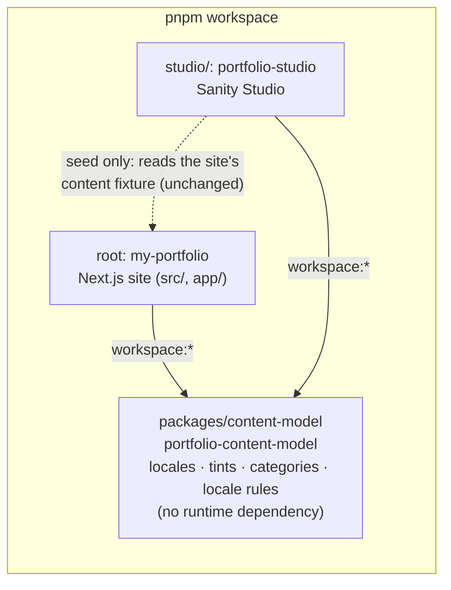

# ADR-004 — A workspace package for the content model shared by the site and the Studio

- **Date:** 2026-10-14
- **Status:** `accepted` (implemented 2026-10-14). Supersedes the "copies accepted" part of [ADR-003](0003-sanity-cms-bilingual-content.md).
- **Deciders:** Carlos Gonzalez Lo Vullo (owner), architect agent

## Context

ADR-003 put the Sanity Studio in its own pnpm workspace package (`studio/`, `portfolio-studio`) and accepted that a few definitions are **copied by hand** between the Studio and the site:

| Definition                                   | Studio copy                                                              | Site copy                                                 |
| -------------------------------------------- | ------------------------------------------------------------------------ | --------------------------------------------------------- |
| Content locales (`en`, `fr`)                 | `LANGUAGES` in `studio/schemaTypes/locales.ts`                           | `LOCALES` in `src/shared/lib/i18n/locale.ts`              |
| Tints, and the subsets for jobs and projects | `TINTS` in `studio/schemaTypes/tints.ts`, inline lists per field         | `TINTS` in `src/_pages/home/model/tints.ts`, `JOB_TINTS`… |
| Project and note categories                  | `studio/schemaTypes/categories.ts`                                       | `src/_pages/home/model/{projects,notes}.ts`               |
| Locale-completeness rules                    | `findLocaleProblems` (`studio/schemaTypes/validation/localeProblems.ts`) | `findProblems` (`src/shared/api/sanity/localized.ts`)     |

ADR-003 relied on the build check to catch drift. That only works one way and late: a value added to the Studio but not to the site fails `pnpm content:check` once content uses it, but a value removed from the Studio, a rule that the two checkers apply differently (blank, duplicate, legacy item), or a new locale added on one side only is caught at best at the next deploy, at worst never. The two locale checkers are about 40 lines each, apply the same five rules, and already differ in small ways (the site attaches a fallback, the Studio a path).

The owner wants these definitions **shared, not copied**.

Constraints:

- The site is FSD, checked by Steiger on `./src` and by dependency-cruiser on `app/` and `src/` (ADR-002). The Studio is outside both.
- The Studio is bundled by Sanity's Vite build (`sanity build` / `sanity deploy`), its schema is loaded in Node by `sanity schema extract` (TypeGen) and `sanity exec` (seed). Sanity's Vite config does not read the tsconfig `paths`: the `@/` alias only works in the Studio's **type-check**, not in its bundle, so a runtime `@/` import from the Studio passes `pnpm typecheck` and breaks `sanity build`.
- The site is built by Next.js 16 with Turbopack, tested by Vitest, rendered by Storybook (Vite), and `scripts/content-check.ts` runs under `tsx`.
- `pnpm typecheck`, `lint`, `lint:arch`, `knip` and `test` must stay green, and the Studio must not pull Next.js, React components or app code.

## Options considered

### Option A — A small workspace package, `packages/content-model` (chosen)

A third pnpm workspace package, `portfolio-content-model`, holds the shared values and the locale rules as plain TypeScript, with no runtime dependency. The site and the Studio both declare it (`workspace:*`) and import it by name. It ships its TypeScript source (`exports` points at `src/index.ts`): there is no build step.

- Pros: one definition of each value and one locale checker, with a single test suite. The dependency is declared in both `package.json` files, so knip and pnpm see it. The direction is right: the site and the Studio both depend on the content model, neither depends on the other. The package's own `tsconfig` has no DOM and no Node types, so it cannot grow a dependency on a runtime. Every tool resolves it the standard way: Turbopack transpiles workspace packages automatically (`node_modules/next/dist/docs/01-app/03-api-reference/05-config/01-next-config-js/transpilePackages.md`), and Vite (Studio, Storybook, Vitest) and `tsx` transform it because the pnpm symlink resolves outside `node_modules`.
- Cons: one more `package.json`, `tsconfig.json` and workspace entry. The Sanity CLI loaders (`schema extract`, `exec`) must transform TypeScript from a linked package; this is verified once during implementation (see the plan).

### Option B — The Studio imports the site's modules directly (rejected)

The Studio imports `src/shared/lib/i18n/locale.ts`, `src/_pages/home/model/tints.ts`… by relative path, and the site's `findProblems` is extracted to a zod-free file the Studio can import.

- Pros: no new package.
- Cons:
  - The Studio depends on the site's internals, below the slices' public APIs. Steiger cannot see it (the importer is outside `src/`), so FSD stops protecting those files: moving `tints.ts` inside the page slice silently breaks the Studio.
  - The public API of `shared/lib/i18n` pulls `'use client'` hooks and `localStorage`; the Studio has to deep-import `locale.ts` to avoid them.
  - The bundling trap above: any future runtime `@/` import in one of those files type-checks in the Studio and breaks `sanity build` only.
  - The undeclared cross-package import is invisible to pnpm and knip.
  - The CMS tooling ends up depending on the website, the reverse of the real relationship.

### Option C — Keep the copies, add a drift test (rejected)

A Vitest test imports both copies and asserts they are equal.

- Pros: the smallest change.
- Cons: the copies stay, so every change is still made twice. It does not address the two locale checkers, whose differences are in behavior, not in data. It is the status quo with a faster alarm.

Also rejected: a code generator that writes the Studio copies from the site (a build step for four constants), a top-level folder imported by relative path without a `package.json` (undeclared dependency, same visibility problem as option B), and deriving the enums from the Sanity schema (TypeGen types an `options.list` as `string[]`, see ADR-003, so the enum types cannot come from the schema).

## Decision

**Chosen: option A, a workspace package `portfolio-content-model` in `packages/content-model/`, consumed by name by the site and the Studio.**

Decisive criteria: one definition per value and one locale checker, declared dependencies that every tool sees, and a dependency direction where neither the site nor the Studio knows the other.

The dotted arrow is the existing exception, unchanged here: `studio/seed/` reads the site's content fixture and types to build the seed documents.

### What the package holds

The package holds **what both sides must agree on for content to be valid**, and nothing that only one side uses:

- the content locales (`LOCALES`, `Locale`, `DEFAULT_LOCALE`, `isLocale`, `Localized<T>`);
- the tints (`TINTS`, `Tint`) and the subsets allowed per document (`JOB_TINTS`, `PROJECT_TINTS`);
- the category enums (`PROJECT_CATEGORIES`, `ProjectCategory`, `NOTE_CATEGORIES`, `NoteCategory`);
- the locale-completeness rules: one function, `findLocaleProblems()`, which returns **structured problems** (a discriminated union by `kind`), plus the helpers derived from it (`missingLocales`, `localizedValue`, `fallbackValue`).

What stays out:

- **Wording.** The Studio says `Français (fr) translation is required` to an editor; the build report says `fr: missing translation` to a developer. Each consumer turns a structured problem into its own message, with an exhaustive `switch` on `kind`.
- **Studio labels** (`English`, `Full-Stack`…) stay in `studio/`, typed `satisfies Record<Locale, string>` / `Record<ProjectCategory, string>`: a value added to the package without a label fails `pnpm typecheck`.
- **Site concerns:** `INTL_LOCALE`, the filters (`PROJECT_FILTERS`), the tint of each note category, the zod schemas, the dev fallback policy.
- **Sanity and zod.** The package imports neither, so the Studio does not get zod and the site does not get Sanity.

## Consequences

- **Positive:**
  - A locale, tint or category is changed in one place; the Studio and the site cannot disagree on what is valid.
  - The Studio's publish gate and the site's build gate apply literally the same rules, tested once.
  - Missing Studio labels or site messages for a new value are type errors, not runtime surprises.
- **Negative / accepted trade-offs:**
  - A third workspace package, with its own `tsconfig.json` and `typecheck` script.
  - The package ships TypeScript source. Every consumer must be able to transform it (true today for Turbopack, Vite, Vitest, `tsx` and the Sanity CLI, verified at implementation). Publishing it to npm, which is not planned, would need a build step.
  - One behavior change in an edge case: in development, a duplicate language no longer gets a fallback value even when its first occurrence was blank; it fails like any other structural problem.
- **Constraints introduced:**
  - A value or a rule needed by both the site and the Studio goes in `packages/content-model/`. A value used by one side only stays on that side.
  - The package has no runtime dependency and imports nothing from `app/`, `src/` or `studio/` (checked by dependency-cruiser).
  - The package exposes one entry point, `src/index.ts`, with named exports only (the same rule as an FSD public API).
  - The site keeps importing locales through `@/shared/lib/i18n`, which re-exports them from the package, so the UI code does not change.
